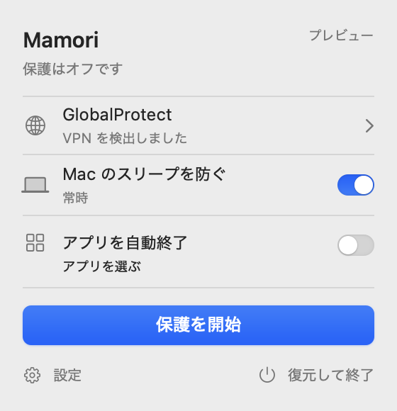

<p align="center">
  
</p>

<h1 align="center">Mamori · 守 · お守り</h1>

<p align="center">Mac を気にする時間を、考える時間に。</p>

<p align="center">
  <a href="README.md">English</a> · <a href="README.zh-CN.md">简体中文</a> · 日本語
</p>

長めの AI タスクを実行しているとき。ビルドの完了を待つとき。調査で集めたデータを処理しているとき。
「途中で Mac が眠っていないかな」と、何度も確かめる手間を減らしたい。

**Mamori · 守 · お守り** は、そんな作業に添える、小さな macOS メニューバーアプリです。必要な時間だけアイドル状態によるスリープを抑え、あとは静かに待ちます。

[**Mac 版をダウンロード（DMG）**](https://github.com/fayerhill/mamori/releases/download/v0.1.0-preview/Mamori-macOS-arm64.dmg) · [リリースを見る](https://github.com/fayerhill/mamori/releases/tag/v0.1.0-preview)

> **現在のソースは 0.2.0 です。** 有効な Apple 署名を付けたローカル版には、実サービスの設定、ネットワーク保護、任意のアプリ終了、完全アンインストールを実装しています。実環境での検証はまだ必要です。公開済みの **v0.1.0-preview** は旧 ad-hoc ビルドで、実際に使えるのはスリープ抑止と読み取り専用の監視です。一般向けの署名済み配布には Developer ID と公証が必要です。

<p align="center">
  
</p>

## 作業に合わせて、眠らせない

「この処理が終わるまで 90 分」でも、「Mamori を開いている間ずっと」でも。
時間を指定するか、実行中ずっと有効にするかを選ぶだけです。タイマーが切れるか、スイッチをオフにするか、Mamori を終了すると解除されます。

画面の消灯とロックはそのまま使えます。席を離れるために、画面をつけっぱなしにする必要はありません。

抑止するのはアイドル時のスリープです。蓋を閉じる操作、明示的なスリープ、低バッテリー、再起動には対応せず、AI サービスやリモートジョブの継続を保証するものではありません。

## 必要なものを、手の届くところに

280 × 290 pt のパネルに、状態と操作をコンパクトにまとめました。メニューバーから開き、設定したら閉じる。それだけで使えます。

システムの書体、標準コントロール、ライト／ダークモード。Mac に馴染む外観を大切にしています。英語・簡体字中国語・日本語は、設定から切り替えられます。

## VPN に応じた動作も、自分で選ぶ

VPN 切断時に、どのアプリを終了させたいか。インストール済みアプリを検索し、まだ起動していないアプリも選んでおけます。選択するだけでアプリが起動することはありません。

署名済みのローカル版では、サービスを設定して接続先とトンネルを確認し、明示的に保護を開始できます。状態はサービスの検証結果に従います。自動終了は確認された切断だけを対象とし、読み取れない接続情報を切断と決めつけません。

同梱の **Mamori Preview** では、接続中から切断へ変わる画面や、選択したアプリの終了フローを試せます。VPN、ファイアウォール、電源、アプリ終了はすべてシミュレーションです。実際に読み取るのはアプリの一覧とアイコンだけです。

自動終了は初期状態でオフ。VPN の自動再接続や、終了したアプリの再起動も行いません。何を有効にするか、いつ再開するかは、自分で決められます。

## 小さく作る理由

- **作業の邪魔をしない。** 常に大きなウィンドウを開く必要はありません。確認したいときだけ、メニューバーから。
- **勝手に始めない。** スリープ抑止も自動終了も、初期状態はオフ。ログイン時の自動起動もありません。
- **使い終わったら解除。** スリープ抑止には一時的な仕組みを使い、システム全体の電源設定を書き換えません。Shell、PATH、DNS、プロキシ設定も変更しません。
- **利用状況を送らない。** テレメトリーはありません。日々の作業を記録するためのアプリではありません。

パネルを閉じても Mamori は動き続けます。終えるときは「復元して終了」から。

設定には、確認付きの**完全アンインストール**もあります。スリープ抑止の解除、ネットワーク復元の確認、サービス登録の解除後に、実行中のアプリ本体と現在のユーザーの専用設定・キャッシュ・サポートファイル・保存状態を完全削除します。ゴミ箱には移動しません。ソース、別のアプリコピー、他のユーザーのデータ、OS のログは対象外です。失敗時は未完了と表示し、プレビューでは削除を模擬するだけです。

## ダウンロードして始める

以下は旧 **v0.1.0-preview** のダウンロードです。**Apple Silicon の Mac／macOS 14 以降**に対応し、実行に Xcode やターミナル操作は不要です。現在の 0.2.0 ローカル署名版は[ビルドと署名の手順](Documentation/Signing.md)を参照してください。

1. [DMG をダウンロード](https://github.com/fayerhill/mamori/releases/download/v0.1.0-preview/Mamori-macOS-arm64.dmg)して開きます。
2. 使いたいアプリを **Applications** にドラッグします。
3. **Mamori** を開き、メニューバーの盾アイコンからスリープ抑止を設定します。
4. 画面や VPN 連携を試す場合は、**Mamori Preview** を開いてください。こちらは常にシミュレーションで動作します。

[リリースページ](https://github.com/fayerhill/mamori/releases/tag/v0.1.0-preview)には、通常版とプレビュー版を個別に入手できる ZIP、クイックスタート、`SHA256SUMS` も用意しています。

公開済みの配布物は **ad-hoc 署名のみで、公証されていない開発ビルド**です。実際の保護は有効にできず、macOS が起動を制限する場合があります。初回起動は[ダウンロードガイド](Documentation/Download.md)をご覧ください。Apple Development 署名版はローカル開発用で、一般配布の代わりにはなりません。

## これからの Mamori

現在のソースでは、サービス設定、切断時のネットワーク拒否の維持、任意のアプリ終了、完全アンインストールまで実装しました。実機の VPN を切断して動作を確認したわけではありません。次の段階では、以下を順に進めます。

- Developer ID 署名と公証を整え、導入と初回起動を改善する。
- 管理されたテスト用 Mac で、ネットワーク遮断、復元、サービス削除、障害時の動作を検証する。
- 実際の GlobalProtect 環境で互換性を確認し、広く配布する前に長期的なネットワーク制御方式を評価する。

すべての VPN への対応や漏えいゼロを約束する段階ではありません。[開発状況と検証記録](Documentation/Progress.md)で、実装済みの範囲と残っている作業を公開しています。

<details>
<summary>開発者向け：ソースから試す・仕組みを読む</summary>

Swift 6、SwiftUI/AppKit、Swift Package Manager を使用し、外部パッケージへの依存はありません。ビルドには Xcode が必要です。

```sh
git clone https://github.com/fayerhill/mamori.git
cd mamori
./Scripts/build.sh
./Scripts/preview.sh
./Scripts/test.sh
```

`Mamori` が UI、`MamoriCore` が純粋な状態遷移とポリシー、`MamoriSystem` がシステム連携、`MamoriGuard` が特権サービスを担当します。コードとコメントは英語です。

署名は `auto` が既定で、Developer ID、Apple Development、ad-hoc の順に選択します。実サービスを含むローカル版は `SIGNING_MODE=dev`、限定プレビュー版は `SIGNING_MODE=adhoc` で指定できます。公開用パッケージ処理は Apple Development 版を拒否します。詳しくは[署名と配布](Documentation/Signing.md)をご覧ください。

テストと署名検証は実通信の保護を証明するものではありません。実 VPN の切断、PF ルール適用、サービス登録、作業中のアプリ終了は行っていません。2 件の外部 IPv4 経路チェックも、フルトンネルの証明にはなりません。

詳しくは[動作仕様](Documentation/Behavior.md)、[ネットワーク保護の制約](Documentation/NetworkGuard.md)、[ビルドと削除](Documentation/Installation.md)を参照してください。

</details>
