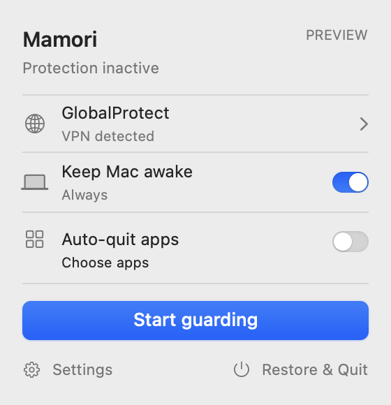

<p align="center">
  
</p>

<h1 align="center">Mamori · 守 · お守り</h1>

<p align="center">Let your Mac stay awake. Let yourself step away.</p>

<p align="center">
  English · <a href="README.zh-CN.md">简体中文</a> · <a href="README.ja.md">日本語</a>
</p>

A small, native menu-bar companion for long AI sessions, builds, and research. Choose how long to keep your Mac awake, start a deliberate VPN guard session, and decide which apps should stop if the connection is lost. One compact panel, with a clear way to finish.

**[Get started with 0.2.1](Documentation/Signing.md)** · [Installation & removal](Documentation/Installation.md) · [Progress](Documentation/Progress.md)

macOS 14+ · Apple silicon local build · English, 简体中文, 日本語

> **0.2.1 is a local development build.** Real helper setup, network guarding, optional app quitting, and complete uninstall are implemented. Service installation and a running helper have been confirmed locally; live network enforcement and complete-uninstall validation remain pending. There is no public notarized 0.2.1 download; the older preview is linked below.

<p align="center">
  
</p>

## Useful while the work takes its time

| Control | What it does |
| --- | --- |
| **Keep Mac Awake** | Keep the Mac awake while Mamori runs or for a chosen duration. The display can sleep and the screen can lock. |
| **Guard GlobalProtect** | While guarding, the implementation retains its default-deny policy after either a manual or accidental VPN disconnection. The helper verifies enforcement and reports its state. |
| **Quit selected apps** | Optionally quit running apps from your installed-app selection after a confirmed VPN loss. Off by default; uncertain evidence does not trigger quitting. Delayed force quit is a separate choice. |
| **Restore & Quit** | Cancel queued app actions, release keep-awake, and wait for owned network resources to be restored before exiting. Settings remain for next time. |
| **Complete Uninstall** | After confirmation, restore owned network resources, unregister the service, and permanently remove this running app and the current user's Mamori data. Failed cleanup stays visible. |

Keep-awake and guarding are independent. Mamori does not reconnect the VPN or reopen apps. Selecting a browser or terminal covers the whole application, including all windows and sessions.

## Start with the current app

1. **Build and sign 0.2.1** using the [signing guide](Documentation/Signing.md). A local Apple Development identity enables the real helper; an ad-hoc build cannot activate it.
2. Extract the clean `build/Mamori.zip` into **Applications**, then open Mamori. Build scripts do not install or start its service.
3. Connect GlobalProtect. In Mamori, choose **Set up protection**, then approve the background service in macOS when requested.
4. Choose **Detect VPN connection**, review the discovered tunnel and gateway, then **Start guarding**. Startup validation belongs to the authenticated helper, not the menu-bar observation alone.
5. Enable keep-awake and optional app quitting as needed. Use **Restore & Quit** when finished, or **Settings → Complete Uninstall** to remove the app.

This is a workflow for a controlled local evaluation. A valid signature, detected tunnel, or passing test suite is not proof of live packet protection.

## Small by choice

**Quiet, familiar controls.** System typography, native controls, light and dark appearance, and three languages. Closing the panel puts it away; it does not stop the session.

**You decide what runs.** Keep-awake and automatic app quitting start off. There is no automatic login launch, VPN reconnection, or app restart. Mamori, VPN controls, and critical system components are excluded from the quit list.

**A modest footprint.** No telemetry. No changes to shell profiles, PATH, DNS, proxies, GlobalProtect settings, or global power preferences. Complete Uninstall removes owned resources, not other copies, source code, other users' data, or macOS logs and authorization records. It deletes directly rather than using Trash.

## What has been verified

**98 Swift tests pass, including nine regressions for the start/quit correction.** A live read-only check confirmed that querying Mamori's nonexistent PF anchor returns `DIOCGETRULES: Invalid argument`. Build 6 checks stable parent-anchor listings before reading owned rules, so a verified missing anchor counts as empty. Failed inspections still retain recovery state. The signed app and helper pass bundle validation. See the [verification record](Documentation/Progress.md) for installation and live-cycle results.

Live VPN disconnection, successful PF enforcement, and real complete-uninstall integration have **not** been validated. The user's Restore & Quit cleared the failed pre-enable session before the update; this does not validate restoration after active PF enforcement. The current guard targets a narrow GlobalProtect configuration; split tunnels, proxies, and universal VPN compatibility are outside its scope. Two sampled routes do not prove full-tunnel coverage. Keep-awake does not override lid closure or explicit sleep, or guarantee remote AI uptime. Read the [network boundaries](Documentation/NetworkGuard.md) before evaluation.

## Older preview download

The published **[v0.1.0-preview](https://github.com/fayerhill/mamori/releases/tag/v0.1.0-preview)** is an older Apple silicon, ad-hoc signed, non-notarized build. Its normal app supports keep-awake and read-only observation; real guarding and automatic app quitting are unavailable. It does not contain the current 0.2.1 functionality.

See the [download guide](Documentation/Download.md) for that release. To explore the current interface safely, build the separate **Mamori Preview**: it simulates VPN, firewall, power, app-quit, and uninstall effects, reading only the installed-app catalog. For real guard evaluation, use the signed local build above.

<details>
<summary><strong>Build, explore, contribute</strong></summary>

Requires Xcode with Swift 6. SwiftUI, AppKit, and Swift Package Manager; no remote package dependencies.

```sh
git clone https://github.com/fayerhill/mamori.git
cd mamori
SIGNING_MODE=dev ./Scripts/build.sh
./Scripts/preview.sh
./Scripts/test.sh
```

Use `SIGNING_MODE=adhoc` for a limited build without a signing identity. `auto` prefers Developer ID, then Apple Development, then ad-hoc. Public packaging rejects Apple Development builds. [Signing details](Documentation/Signing.md).

`Mamori` owns the interface, `MamoriCore` the session and policy, `MamoriSystem` native adapters, and `MamoriGuard` the privileged service. The next milestones are controlled integration tests and Developer ID signing with notarization. [Report an issue](https://github.com/fayerhill/mamori/issues) without private VPN addresses or credentials.

</details>

[Behavior](Documentation/Behavior.md) · [Network design](Documentation/NetworkGuard.md) · [Installation & removal](Documentation/Installation.md) · [Progress](Documentation/Progress.md)
