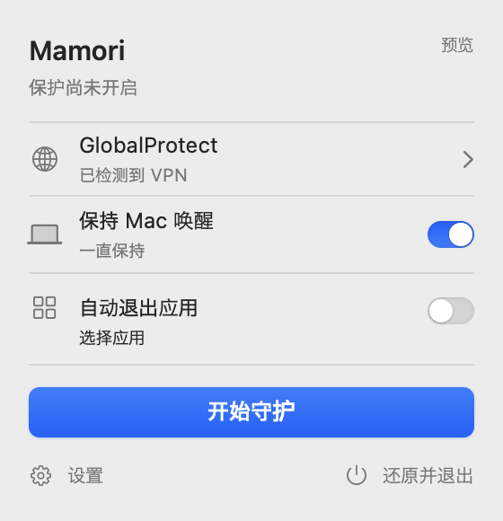

<p align="center">
  
</p>

<h1 align="center">Mamori · 守 · お守り</h1>

<p align="center">让 Mac 保持唤醒，把注意力留给手上的事。</p>

<p align="center">
  <a href="README.md">English</a> · 简体中文 · <a href="README.ja.md">日本語</a>
</p>

Mamori 是一个轻巧的原生 macOS 菜单栏工具。开始一段 AI 工作、等待构建，或整理需要较长时间的研究资料时，打开保醒，选好时长，然后继续做你的事。

它留在菜单栏里。你需要时，点开一个小面板；工作结束时，明确地停止或退出。

> **当前为开发预览版。** 普通版可使用保持唤醒和只读 GlobalProtect 观察。网络守护与断线自动退出目前只能在安全预览中体验；真实启用仍需要 Developer ID 签名的应用与后台服务，以及单独的受控验证。

<p align="center">
  
</p>

## 适合这些时候

- **让 AI 继续工作。** 给较长的编程、分析或资料整理任务留出时间，减少因 Mac 自动睡眠而中断本地运行的情况。
- **等待构建或导出。** 设定一段保醒时间，不必为了一个任务改动系统的长期电源设置。
- **离开桌面一会儿。** 屏幕可以熄灭，Mac 也可以锁屏；保醒不要求你一直亮着屏幕。

Mamori 防止的是自动空闲睡眠。它不保证阻止合盖、主动睡眠、关机或低电量睡眠，也不能保证远端 AI 服务或任务持续运行。

## 小，但把控制交给你

**只保醒你需要的时间。** 选择在 Mamori 运行期间持续保醒，或设定自定义时长。计时结束会停止，退出应用也会释放保醒。关闭小面板则不会退出菜单栏应用。

**熟悉的 Mac 界面。** 原生控件、紧凑布局和浅色／深色外观；支持英语、简体中文和日语。日常操作不需要打开终端。

**看得见当前状态。** 普通版只读观察 GlobalProtect 的本机连接线索，并区分已检测、未连接和无法确认。检测到 VPN 并不代表 Mamori 已提供防火墙保护。

**先体验，再决定。** 单独的 Mamori Preview 可以模拟 VPN 断开和恢复，预览网络守护与应用退出流程。应用选择器支持搜索已安装的应用，包括尚未运行的应用；它只读取列表和图标，不会启动或退出它们。

## 安静，是一种选择

Mamori 围绕一段由你开始、由你结束的工作时间设计。保醒与网络守护各自独立，不会因为切换一个功能，就悄悄改变另一个功能的状态。

它不自动重连 VPN，不自动重开已退出的应用，也不在登录时自行启动。没有账号、遥测或后台数据上传；不改动你的 DNS、代理、GlobalProtect 设置或 Shell 配置。

我们希望保留的是明确的状态、直接的操作和可靠的退出路径。更多开关，只有在确实有用时才加入。

## 下载并开始

**[下载 macOS DMG](https://github.com/fayerhill/mamori/releases/download/v0.1.0-preview/Mamori-macOS-arm64.dmg)** · [v0.1.0-preview 发布说明与校验文件](https://github.com/fayerhill/mamori/releases/tag/v0.1.0-preview)

适用于 **Apple Silicon、macOS 14 或更新版本**。当前下载为 **ad-hoc 签名、尚未公证的开发构建**，不应作为已经验证的网络防护产品使用。

1. 下载并打开 DMG，将需要的应用拖入 **Applications**。
2. 打开 **Mamori**，点击菜单栏的盾牌，开启保醒并选择时长。想先试界面，可以打开 **Mamori Preview**。
3. 工作结束后关闭保醒，或选择 **还原并退出**。

DMG 包含两个应用：

| 应用 | 用途 |
| --- | --- |
| **Mamori** | 实际保醒与只读 GlobalProtect 观察；保醒默认关闭。 |
| **Mamori Preview** | 模拟守护流程；不改变真实 VPN、防火墙、电源断言或其他应用。 |

安装无需 Xcode、Homebrew 或命令行配置。如果 macOS 阻止打开，请先阅读[下载说明](Documentation/Download.md)，再自行判断是否信任此开发构建；无需关闭 Gatekeeper。

## 正在走向哪里

当前重点是把保醒与简洁界面做好。下一步是完成签名、公证，以及独立测试环境中的后台服务安装、恢复和移除验证。

网络守护的目标是在 VPN 断开时仍保留网络阻断，并按你的选择退出应用。这部分仍在验证阶段，尚不承诺支持所有 VPN、代理或网络配置，也不承诺零泄漏。

自动退出将只处理明确选中的应用，不会自动恢复它们。选择浏览器或终端意味着整个应用及其所有窗口；关键系统组件、Mamori 自身和 VPN 控制组件不在可退出名单中。

[查看开发进度与里程碑](Documentation/Progress.md)

<details>
<summary>开发者：本地构建与技术文档</summary>

需要 Xcode 和 Swift 6。项目使用 Swift Package Manager，没有第三方软件包依赖。

```sh
git clone https://github.com/fayerhill/mamori.git
cd mamori
./Scripts/build.sh
./Scripts/preview.sh
```

预览采用模拟操作，不要求断开真实 VPN。隔离测试可通过 `./Scripts/test.sh` 运行；测试通过不等于真实网络阻断已获验证。

- [构建、安装与移除](Documentation/Installation.md)
- [生命周期与行为约定](Documentation/Behavior.md)
- [网络守护的架构、前提与限制](Documentation/NetworkGuard.md)

代码与代码注释使用英语。若将来安装了真实后台服务，移除应用前必须先确认网络资源已还原，再移除服务；不要删除尚待恢复的记录。

</details>
